# Job-tools-platform

A job-related platform with a variety of tools to help with job hunting, starting with an application tracker. It's designed with neurodivergent jobseekers in mind: plain language, a calm layout, and support resources on disclosure and workplace adjustments.

**[Try the live demo](https://job-tools-platform.vercel.app/)**

## Features

- ✅ **Authentication** – secure sign up and log in so each user's applications, notes, and data stay private
- ✅ **Application Tracker** – add your job applications, see them in a table (newest first), edit them (the form opens with the current details), and delete them (with a confirmation step). Each user only sees their own applications
- ✅ **Notes** – write notes such as recruiter calls, interview thoughts or technical notes, each with a category. You can add, view (newest first), edit and delete them
- ✅ **404 and error pages** – friendly pages for missing URLs and unexpected errors, with a way back home

## Planned Features

- **Application Tracker improvements** – filter by status, an Assessment status for tests and assessment centres, and changing status straight from the table
- **Job Boards and Communities** – a curated list of job boards and jobseeker communities, including inclusive and neurodiversity-friendly ones
- **Cover Letter Templates** – templates to copy and adapt for each application
- **Interview Question Guide** – common interview questions by type, with tips and the STAR method
- **Neurodivergent Support** – resources on disclosure, interview adjustments and workplace accommodations, plus adjustment request templates
- **Dashboard** – simple stats on your job search: applications by status, applications per week, and response rate

## Design

Wireframes of every page, drawn before building them. They're a snapshot of the current plan: the built pages may look a little different, and the planned pages will change as they're built.

### Built pages

**Home** (signed out)

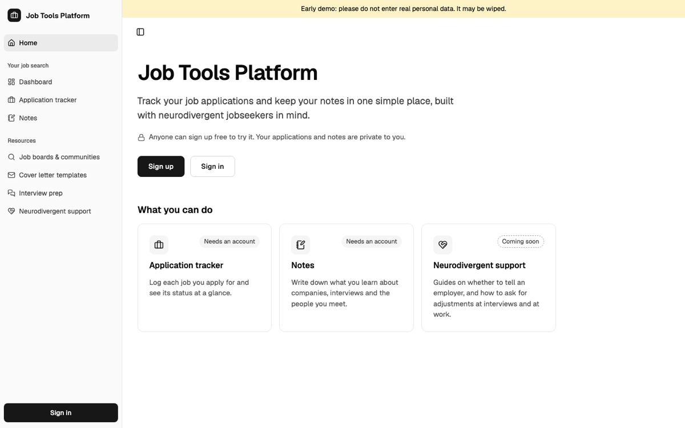

**Application tracker**

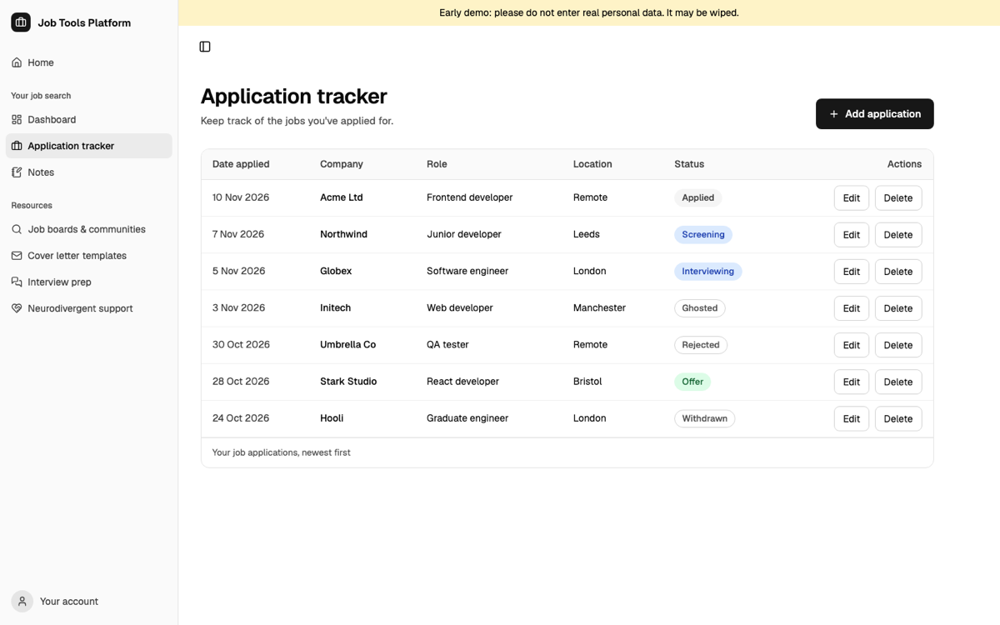

**Application tracker on a phone**

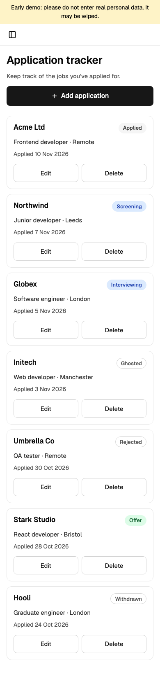

**Notes**

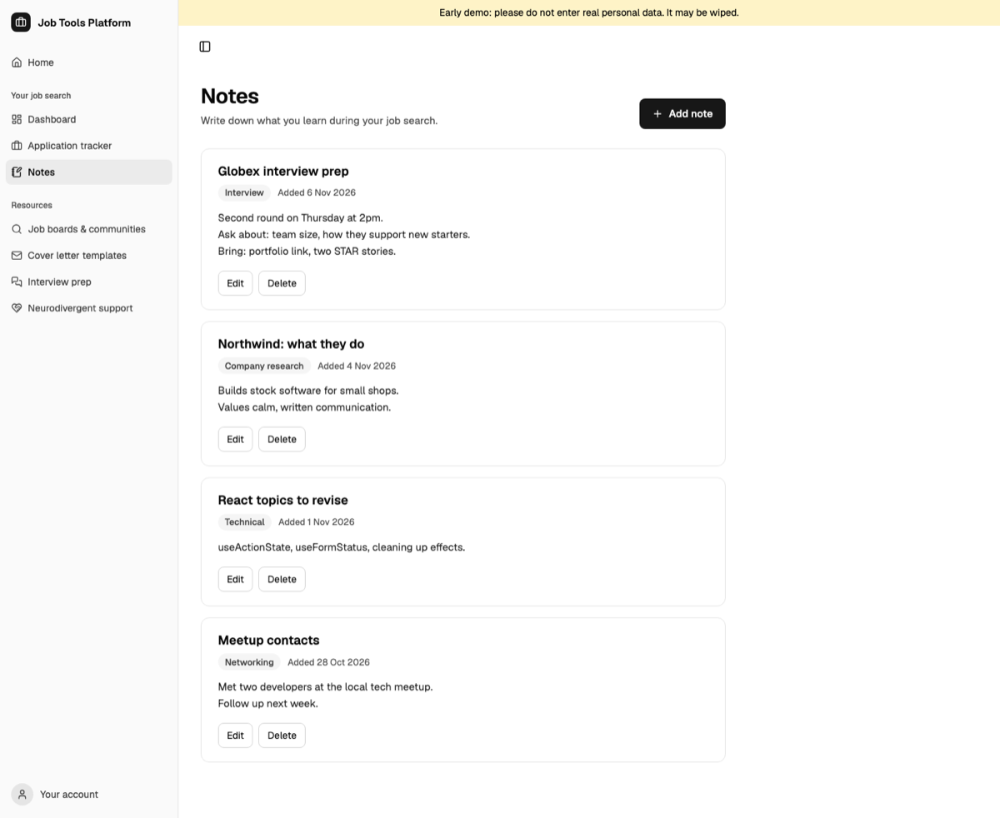

**Empty states**

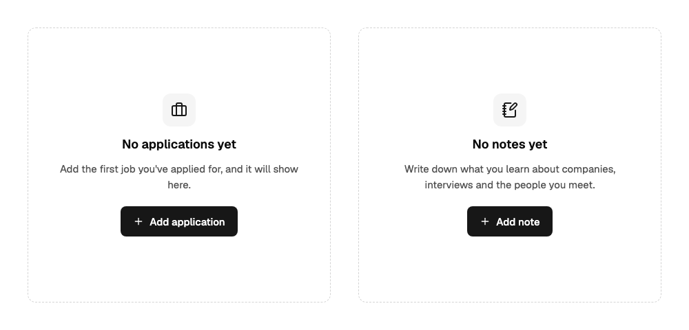

<details>
<summary><strong>Planned pages</strong></summary>

**Dashboard**

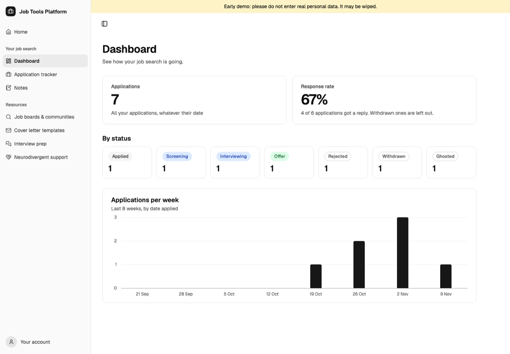

**Neurodivergent support**

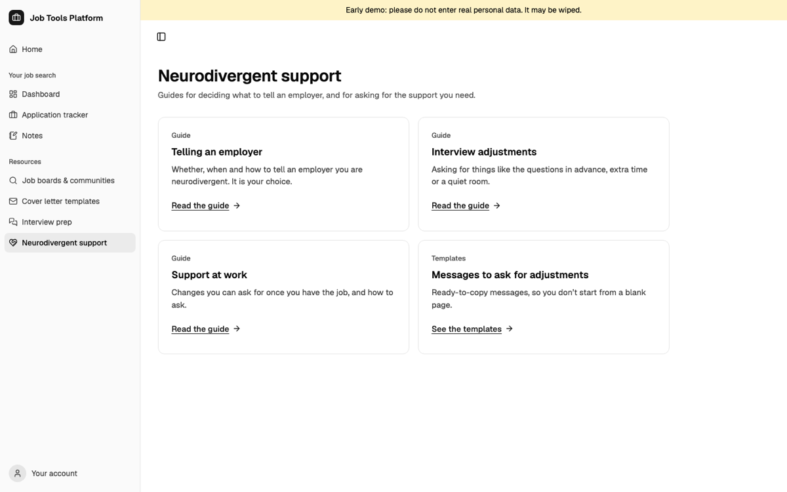

**Job boards & communities**

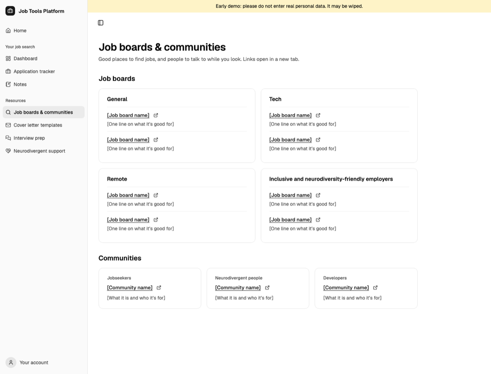

**Cover letter templates**

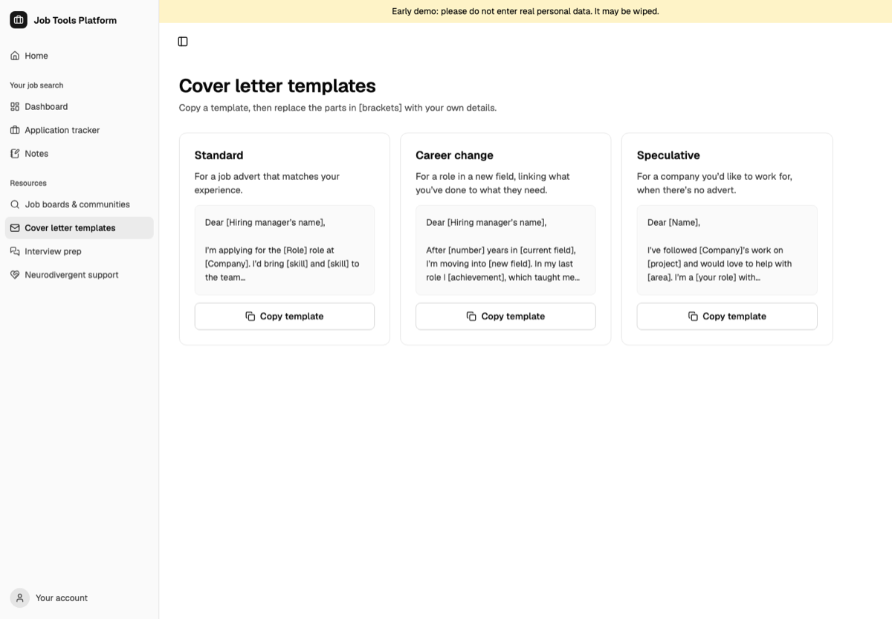

**Interview prep**

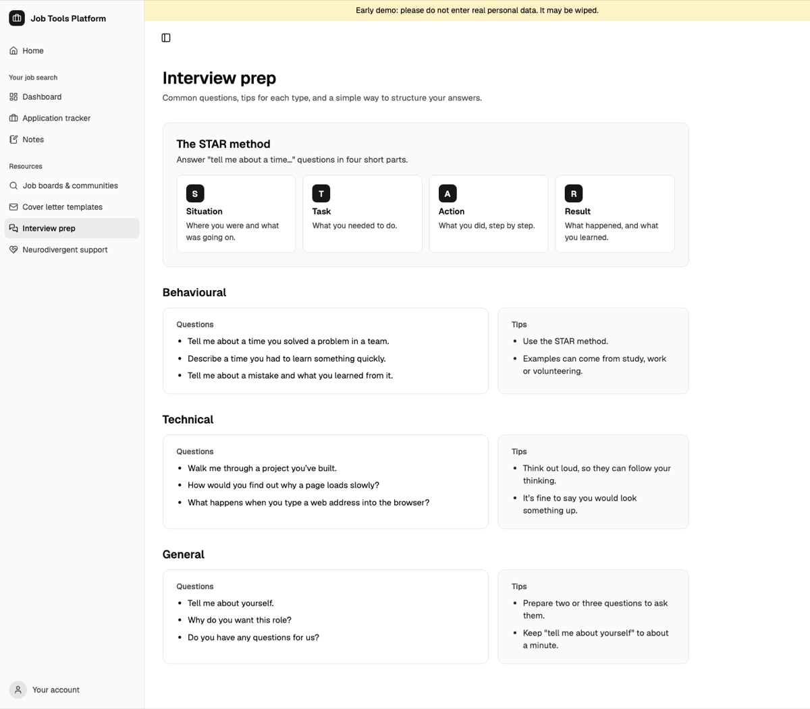

</details>

<details>
<summary><strong>Other screens</strong></summary>

**Private page, signed out**

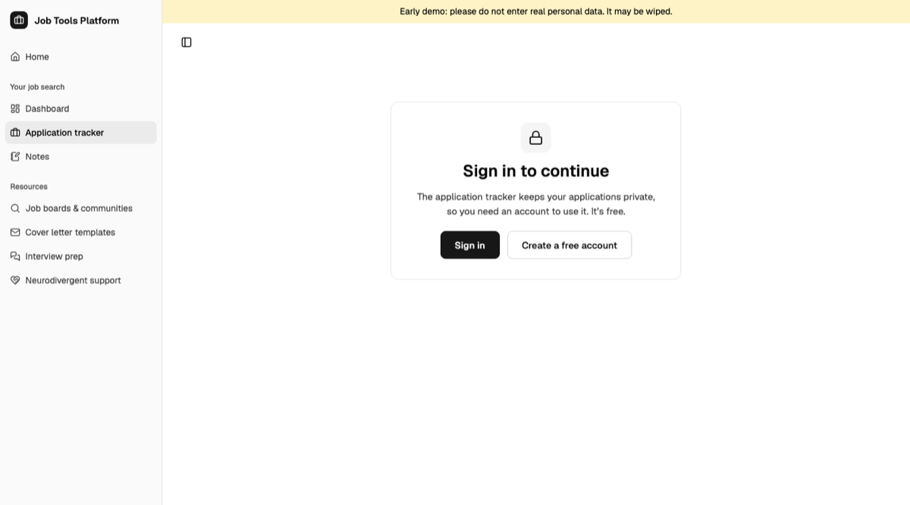

**Sign in**

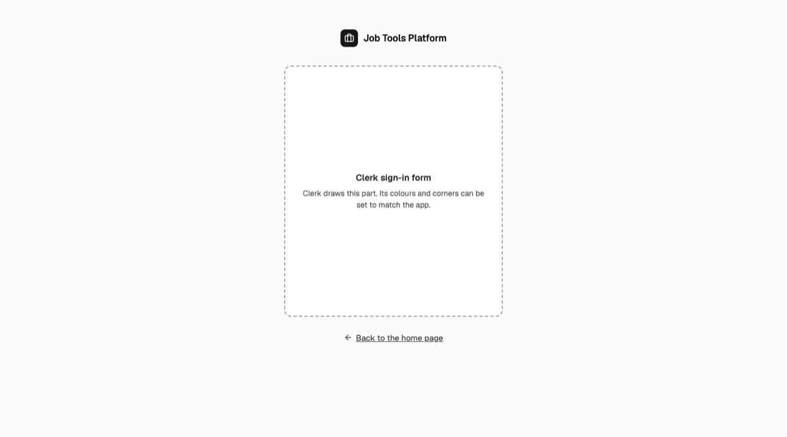

**Page not found**

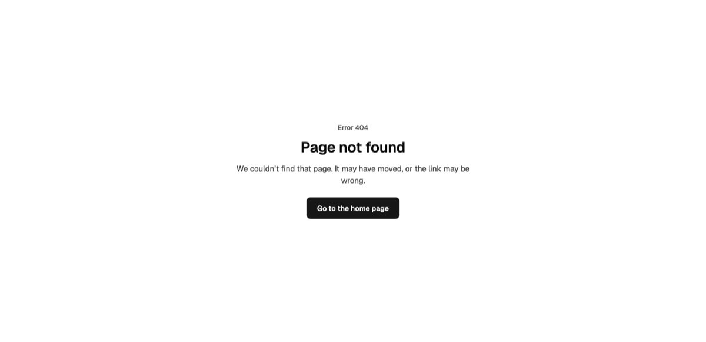

**Error page**

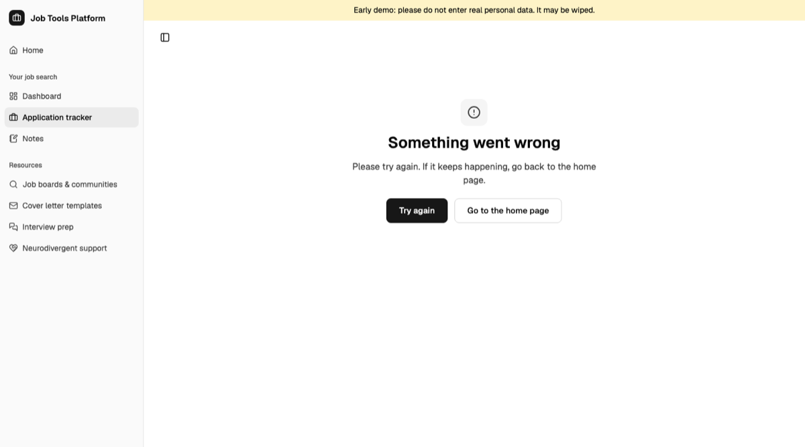

</details>

## Tech Stack

- [Next.js](https://nextjs.org/)
- [TypeScript](https://www.typescriptlang.org/)
- [Tailwind CSS](https://tailwindcss.com/)
- [shadcn/ui](https://ui.shadcn.com/)
- [Base UI](https://base-ui.com/)
- [Clerk](https://clerk.com/) – authentication
- [Neon](https://neon.tech/) – Postgres database
- [Drizzle](https://orm.drizzle.team/) – database ORM

## Getting Started

### Prerequisites

- [Node.js](https://nodejs.org/) 20.9 or later
- A free [Clerk](https://clerk.com/) account
- A free [Neon](https://neon.tech/) account

### Setup

1. Install dependencies:

   ```bash
   npm install
   ```

2. Create a `.env` file in the project root with the following variables. Get the two Clerk keys from the Clerk dashboard under **API Keys**, and the database URL from your Neon project's **Connect** button. Never commit this file.

   ```bash
   # Clerk
   NEXT_PUBLIC_CLERK_PUBLISHABLE_KEY=your_publishable_key
   CLERK_SECRET_KEY=your_secret_key

   NEXT_PUBLIC_CLERK_SIGN_IN_URL=/sign-in
   NEXT_PUBLIC_CLERK_SIGN_UP_URL=/sign-up
   NEXT_PUBLIC_CLERK_SIGN_IN_FALLBACK_REDIRECT_URL=/
   NEXT_PUBLIC_CLERK_SIGN_UP_FALLBACK_REDIRECT_URL=/

   # Neon
   DATABASE_URL=your_neon_connection_string
   ```

   Use `.env`, not `.env.local`: Drizzle's migration tool only reads `.env`.

3. Create the database tables by running the migrations:

   ```bash
   npx drizzle-kit migrate
   ```

4. Start the development server:

   ```bash
   npm run dev
   ```

   Then open [http://localhost:3000](http://localhost:3000).

### Scripts

- `npm run dev` – start the development server
- `npm run build` – build the app for production
- `npm run start` – run the production build
- `npm run lint` – check the code with ESLint
- `npx tsc --noEmit` – type check the code
- `npx drizzle-kit generate` – create a migration after changing `lib/db/schema.ts`
- `npx drizzle-kit migrate` – apply migrations to the database
- `npx drizzle-kit studio` – browse the database in the browser

## Project Structure

- `app/(app)/` – pages that show the sidebar (home, job boards, interview prep, etc.)
- `app/(app)/(private)/` – pages that need signing in (dashboard, applications, notes, etc.). Signed-out visitors see a sign-in message instead
- `app/(app)/(private)/applications/` – the application tracker: `page.tsx`, `actions.ts` (server actions for adding, editing and deleting applications) and `_components/` (the add/edit/delete dialogs)
- `app/(app)/(private)/notes/` – notes: `page.tsx`, `actions.ts` (server actions for adding, editing and deleting notes) and `_components/` (the add/edit/delete dialogs)
- `_components/` folders – components used by only one feature. The `_` prefix tells Next.js they aren't routes
- `app/(app)/error.tsx` and `app/not-found.tsx` – error and 404 pages
- `app/(auth)/` – sign in and sign up pages
- `components/` – components shared across the app: the sidebar, demo banner and coming soon message
- `components/ui/` – shadcn/ui components
- `hooks/` – React hooks (`use-mobile.ts` tells the sidebar when to switch to its phone layout)
- `lib/db/` – database connection and Drizzle schema
- `lib/utils.ts` – small shared helpers
- `drizzle/` – database migrations
- `proxy.ts` – runs Clerk on every request so pages and server actions know who is signed in
- `CODING_STANDARDS.md` – the rules the code follows: ownership checks, validation, naming, comments, tests and accessibility
